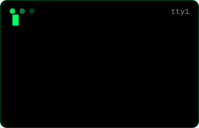

<div align="center">


</div>

<table>
<tr>
<td width="60%" valign="top">
 shalabh.exe --wake / human: raipur, IN / B.Tech CSE // builder / sleep.exe not found / hello, world.">
</td>
<td width="40%" align="right" valign="top">

</td>
</tr>
</table>

<div align="center">

<a href="https://github.com/heyshalabh"></a>
&nbsp;&nbsp;&nbsp;
<a href="https://www.linkedin.com/in/shalabh-sumann/"></a>

</div>

```bash
shalabh@raipur:~$ ls ~/projects --verbose
```

| module | payload | tags | repo |
|:--|:--|:--|:--|
| `MatsMate` | Attendance management system | `attendance` `web` | — |
| `CampSetu` | Campus community platform | `campus` `community` | [`open`](https://github.com/heyshalabh/CampSetu) |
| `DecodeCV` | Resume skill & keyword processor | `resume` `keywords` | — |
| `WhatsApp-Bot` | Schedules & sends WhatsApp messages | `Python` `pywhatkit` | [`open`](https://github.com/heyshalabh/WhatsApp-Automation-Bot) |

```bash
shalabh@raipur:~$ cat skills.log
[web  ]  HTML · CSS · JavaScript
[code ]  Java · Python
[cloud]  Firebase
[ship ]  Git · GitHub
shalabh@raipur:~$ _
```

<div align="center">


<br>


</div>
